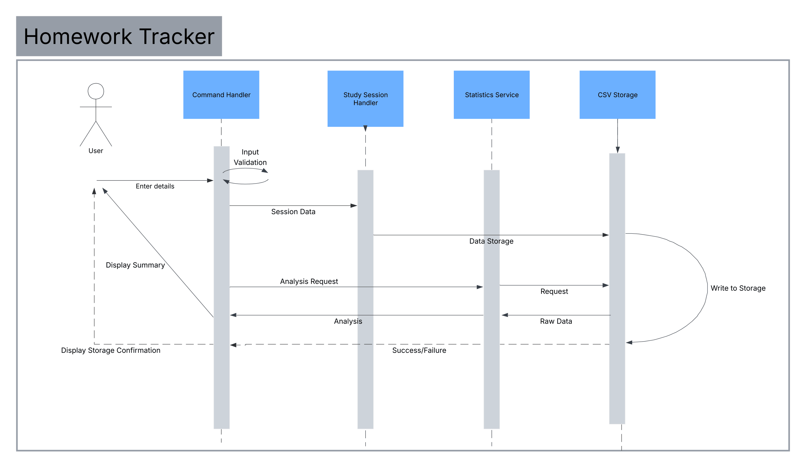

# Study Tracker
### Overview
A tool for tracking study time

## The Problem

I have a difficult time keeping track of my study habits. I would like to know more about how I spend my time, which is why I am building this tool.

## How It Works

Study Tracker is a command-line application that allows users to record and manage study sessions. Users interact 
with the program through commands to track time spent studying, organize sessions by subject, and review historical data.

## Tech Stack

- **Language:** Java 
- **Libraries:** Gradle, JUnit, picocli
- **External tools:** GraalVM

## Setup

Precompiled releases are available on the
[GitHub Releases page](https://github.com/BenS11/study-tracker/releases).

Download the appropriate executable for your operating system.

### Prerequisites
- Supported OS (Windows until further notice)
- That's it! Just run the executable

#### Alternative Options
- Instead of the exe, the user can compile and run the code - requires java 25
Steps:
1. Download a java 25 distribution 
    - I recommend [Eclipse Temurin](https://adoptium.net/temurin/releases)
2. Clone the repo using `git clone https://github.com/BenS11/study-tracker.git`
    - or download and unzip the zip file from [GitHub](https://github.com/BenS11/study-tracker)
3. Using the command line, cd into the newly created directory: `cd study-tracker`
4. Use Gradle to compile and run 
   - Windows: `./gradlew.bat run`
   - Mac/Linux: `./gradlew run`

## Usage

All available commands are documented in [Commands.md](docs/Commands.md), or type help in the cli to get started. 

### Notes
- A directory called .studytracker will be created in the user's home directory.
## Roadmap

- [x] CLI Interface
- [x] Data Storage
- [x] Study Analysis
- [x] Testing
- [x] Study Subject Tracking
- [ ] GUI Interface
- [ ] Homework Tracking
- [ ] Misc. fun features
## Author

Benjamin Simpson - [Github](https://github.com/BenS11)