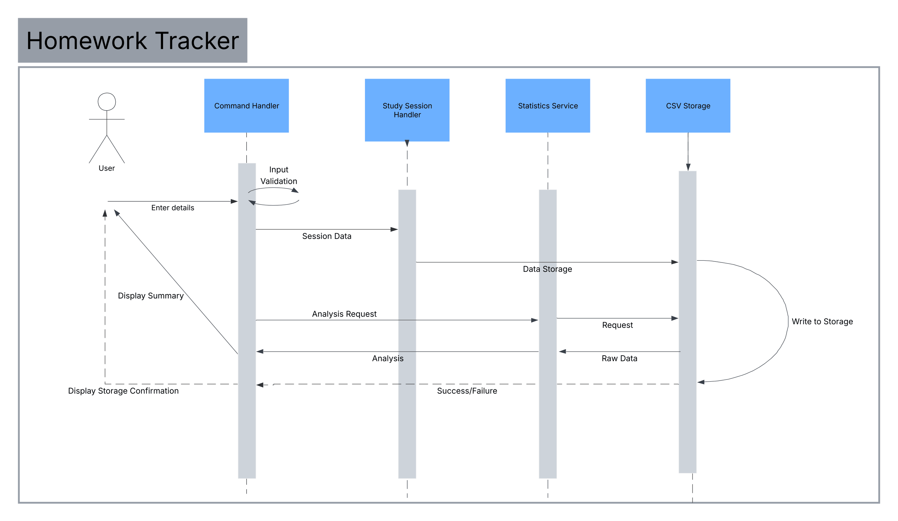

# Study Tracker
### Overview
A tool for tracking study time, with analysis of the time spent on different subjects.

## The Problem

I have a difficult time keeping track of my study habits. I would like to know more about how I spend my time, which is why I am building this tool.

## How It Works

This is a command line tool (with plans to expand to a GUI). The user will input commands, entering study data, or querying about past study sessions. They will be able to record the start and end of sessions, categorize by subject, and see trends. 



## Tech Stack

- **Language:** Java 
- **Libraries:** Gradle, JUnit, JavaFX
- **External tools:** None, as of now.

## Setup

As of now the project is still in development

### Prerequisites
- Java 21

## Usage


### Commands
```bash
study-tracker help
```

## Roadmap

- [ ] CLI Interface
- [ ] Data Storage
- [ ] Study Analysis
- [ ] Testing
- [ ] Study Subject Tracking
- [ ] GUI Interface
- [ ] Homework Tracking
- [ ] Misc. fun features
## Author

Benjamin Simpson - [Github](https://github.com/BenS11)